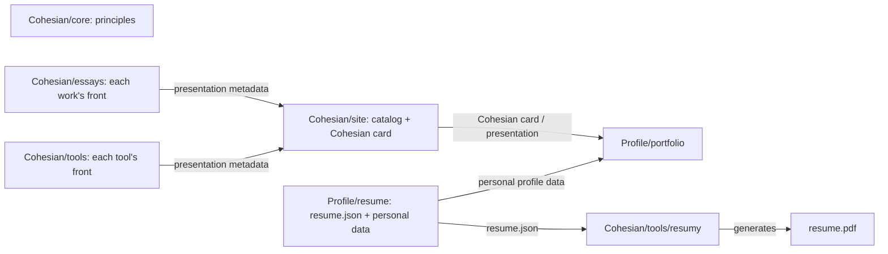

# Workspace Architecture

## 1. Purpose and boundaries

`Workspace/` is the **root of a tree of independent Git repositories**. Its own Git history contains only the index: `README.md`, `AGENTS.md`, `ARCHITECTURE.md`, `repositories.json`, `.gitignore`, and its two scripts.

`Cohesian/`, `Profile/`, and `Projects/` are **local containers**, ignored completely by the index Git repository. Their contents are standalone repositories with their own remotes, branches, and histories. The index does not use Git submodules or try to coordinate commits across projects.

## 2. Full repository tree

The comments show each project's exact `GitHub owner/repository` mapping. Directory names reflect local organization, not necessarily GitHub ownership.

```text
Workspace/                               # root index repository (not a project monorepo)
├── .gitignore                           # ignores /Cohesian/ and /Profile/
├── AGENTS.md                            # agent entrypoint
├── ARCHITECTURE.md                      # human-readable structure and relationships
├── README.md                            # human entrypoint
├── repositories.json                    # machine-readable repo routing map
├── scripts/
│   ├── setup-termux.sh                  # Termux packages + GitHub authentication
│   └── bootstrap.sh                     # create directories + clone missing repos
├── Cohesian/                            # IGNORED by root Git
│   ├── core/                            # cohesian/core
│   ├── site/                            # cohesian/site
│   ├── essays/
│   │   ├── bookly-up/                   # cohesian-essays/bookly-up
│   │   ├── composition-in-go/           # cohesian-essays/composition-in-go
│   │   ├── intro-to-golang/             # cohesian-essays/intro-to-golang
│   │   └── research/                    # cohesian/research
│   └── tools/
│       ├── devky/                       # cohesian-tools/devky
│       ├── josly/                       # cohesian-tools/josly
│       ├── k-graph/                     # cohesian-tools/k-graph
│       ├── loci/                        # cohesian-tools/loci
│       ├── optional/                    # cohesian-tools/optional
│       ├── resumy/                      # cohesian-tools/resumy
│       └── tether/                      # cohesian-tools/tether
├── Profile/                             # IGNORED by root Git
│   ├── leetcode/                        # lucas-masiero/leetcode
│   ├── pj-homesolution/                 # lucas-masiero/pj-homesolution
│   ├── portfolio/                       # lucas-masiero/portfolio
│   └── resume/                          # lucas-masiero/resume
└── Projects/                            # IGNORED by root Git
    └── bookly-up/
        ├── auth/                        # bookly-up/auth
        ├── booking/                     # bookly-up/booking
        └── payment/                     # bookly-up/payment
```

**Total: 20 project repositories** — 13 under `Cohesian/`, 4 under `Profile/`, and 3 under `Projects/`. The index is a separate outer Git repository, if initialized or cloned.

`repositories.json` contains these same path mappings in a machine-readable form and is the authoritative routing list for the bootstrap. The tree above exists to make the architecture easy to inspect without tooling.

## 3. Cohesian: organization and publication

`Cohesian` is the organization. Its work is divided into:

- **`core`** — foundational principles and ideas of the organization.
- **`site`** — the organization's public frontend, which presents essays and tools.
- **`essays`** — published written works. `intro-to-golang` is a book introducing Go; `bookly-up` is a book about a booking-system architecture; `composition-in-go` is a KGraph-authored essay in progress about recursive Go processors and combinatorial configuration potential. `research` is a separate research repository under the `cohesian` GitHub namespace.
- **`tools`** — independently developed tools: `devky`, `josly`, `k-graph`, `loci`, `optional`, `resumy`, and `tether`. In particular, `resumy` is the resume PDF generator. The specific purpose and implementation of the other tools must be learned from their individual repositories.

### The `front` presentation boundary

Each essay and tool acts as a node that exposes a small **`front`**, meaning presentation metadata such as a **title**, **description**, and **cover** (a link to an SVG or PNG). `Cohesian/site` consumes these presentations to display the organization's catalog.

This describes an **information contract**, not a specific framework or transport. The `front` format and access mechanism are determined by the source projects and must be verified in their code.

`Cohesian/site` also exposes a compact Cohesian **presentation/card** used by `Profile/portfolio`. This lets the portfolio present the organization without becoming the owner of Cohesian's content.

## 4. Profile: personal information and presentation

`Profile` is independent of the Cohesian organization even though the portfolio showcases Cohesian work.

- **`resume`** owns the personal/career source data, organized around personal information, education (university and technical skills), work experience, and projects. The projects include home solutions, Cohesian (its two books and tools), and personal LeetCode work.
- **`portfolio`** is the personal frontend. It consumes personal/resume information from `Profile/resume` and Cohesian-specific information through `Cohesian/site`.
- **`pj-homesolution`** is a personal project repository.
- **`leetcode`** contains personal algorithmic problem solutions.

### Resume generation

`Profile/resume` contains `resume.json`, an instance of a resume schema. The `Cohesian/tools/resumy` tool uses that data to produce a structured `resume.pdf`.

The exact schema, command line, and file locations beyond `resume.json` are defined by the respective repositories; this index does not prescribe them.

## 5. Projects: personal projects

`Projects` is a space that contains different projects including from different owners. Its work is divided into:

- **`bookly-up`** is a project for booking it contains different repository modules:
- **auth** an authentication module
- **booking** a booking system module such as reservations
- **payment** a payment module

## 6. Conceptual information flow



`core` is shown as a foundation of the organization; no specific runtime dependency between `core` and the site is assumed.

## 7. Operational model

1. Clone or unpack the **index repository** into `Workspace/`. Its three project-family directories may not yet exist.
2. On Termux, run `scripts/setup-termux.sh` to install the packages and configure GitHub SSH / CLI authentication; **no repositories are cloned by this script**.
3. Run `scripts/bootstrap.sh` to read `repositories.json`, create directory parents, and clone **only missing project repositories** over SSH.
4. The bootstrap treats existing valid repositories as complete, regardless of whether they are current. It does not `fetch`, `pull`, `reset`, or delete local data.
5. Use Git separately inside each project. The root index Git only versions the map, docs, and scripts; it ignores `Cohesian/`, `Profile/`, and `Projects/` entirely.

This is an index and bootstrap arrangement, **not** a monorepo, package manager, deployment system, or automatic multi-repository synchronization tool.
