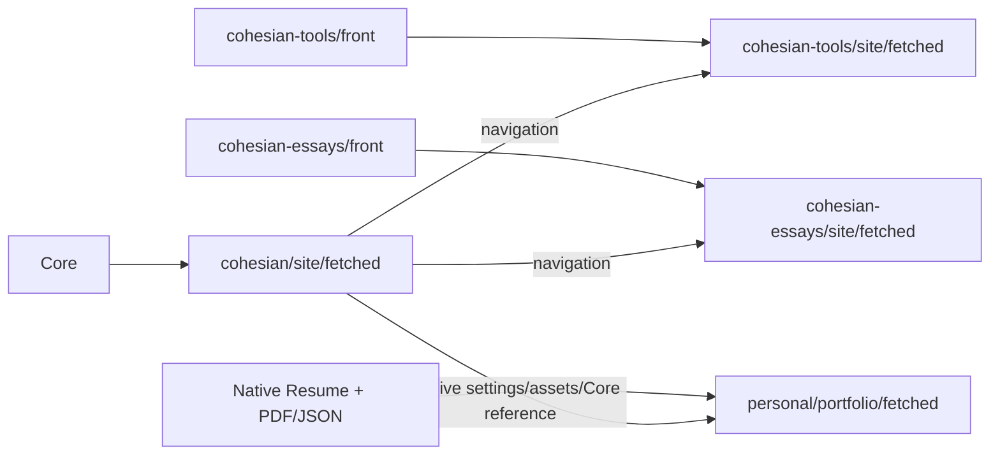

# Workspace Architecture

Workspace is an index of independent repositories, with three local families:
organization, personal and projects. Its own Git history owns .workit.toml, documentation and small setup scripts. The CLI is the independent
cohesian-tools/workit Go module. It ignores all nested project trees;
there are no Git submodules and no shared application build.

## Routing

The workstation nodes in .workit.toml are the source of truth for exact
local-path/GitHub mappings. Namespace parents are explicit. Registered
checkouts may be absent: workit sync workdir add clones missing repos, preserves
existing directories and never resets or pulls. Existing source repositories
are retained when their implementations have been reused in a newer tool.

<!-- workspace-repositories:start -->
| Local path | GitHub repository |
|---|---|
| `organization/cohesian-essays/essays/bookly-up` | `cohesian-essays/bookly-up` |
| `organization/cohesian-essays/essays/composition-in-go` | `cohesian-essays/composition-in-go` |
| `organization/cohesian-essays/essays/compositional-morphodynamics` | `cohesian-essays/compositional-morphodynamics` |
| `organization/cohesian-essays/essays/dimensional-invariance` | `cohesian-essays/dimensional-invariance` |
| `organization/cohesian-essays/essays/intro-to-golang` | `cohesian-essays/intro-to-golang` |
| `organization/cohesian-essays/essays/research` | `cohesian/research` |
| `organization/cohesian-essays/front` | `cohesian-essays/front` |
| `organization/cohesian-essays/site` | `cohesian-essays/site` |
| `organization/cohesian-tools/front` | `cohesian-tools/front` |
| `organization/cohesian-tools/site` | `cohesian-tools/site` |
| `organization/cohesian-tools/tools/devky` | `cohesian-tools/devky` |
| `organization/cohesian-tools/tools/josly` | `cohesian-tools/josly` |
| `organization/cohesian-tools/tools/k-graph` | `cohesian-tools/k-graph` |
| `organization/cohesian-tools/tools/loci` | `cohesian-tools/loci` |
| `organization/cohesian-tools/tools/optional` | `cohesian-tools/optional` |
| `organization/cohesian-tools/tools/resumy` | `cohesian-tools/resumy` |
| `organization/cohesian-tools/tools/tether` | `cohesian-tools/tether` |
| `organization/cohesian-tools/tools/typy` | `cohesian-tools/typy` |
| `organization/cohesian-tools/tools/workit` | `cohesian-tools/workit` |
| `organization/cohesian/arch` | `cohesian/arch` |
| `organization/cohesian/core` | `cohesian/core` |
| `organization/cohesian/site` | `cohesian/site` |
| `personal/portfolio` | `lucas-masiero/portfolio` |
| `personal/repositories/leetcode` | `lucas-masiero/leetcode` |
| `personal/repositories/pj-homesolution` | `lucas-masiero/pj-homesolution` |
| `personal/resume` | `lucas-masiero/resume` |
| `projects/bookly-up/auth` | `bookly-up/auth` |
| `projects/bookly-up/booking` | `bookly-up/booking` |
| `projects/bookly-up/payment` | `bookly-up/payment` |
<!-- workspace-repositories:end -->

## Local namespace layout

```text
organization/
  cohesian/{arch,core,site}
  cohesian-tools/{front,site,tools/<repository>}
  cohesian-essays/{front,site,essays/<repository>}
personal/
  resume
  portfolio
  repositories/{leetcode,pj-homesolution}
projects/
  bookly-up/{auth,booking,payment}
```

Folders are organizational containers; only the indexed leaves are Git repos.
A local namespace does not change GitHub ownership: research, for example,
still belongs to cohesian/research. The old combined cohesian/front is no longer
an active checkout/index entry; its remote history remains intact.

## Consumer-owned presentation

organization/cohesian/arch owns the detailed architecture. The gateway consumes
only immutable Core reference data. Each domain Front owns its presentation
catalog, schemas and assets; each domain Site consumes only that Front.
Individual tools and essays remain agnostic, without front exports.



Sites and Portfolio use `npm run fetch` followed by `npm run build`.
`--local` reads configured sibling inputs; default fetch reads published refs.
Build uses only versioned fetched/ data and consumer-owned presentation code.
A source has no responsibility for downstream rendering.

Site owns site.json and presentation/core.json. Portfolio owns field selection
and Cohesian card assets/styles under presentation/. Resume owns native CV
sources, PDF/JSON output and Resumy configuration. Neither exposes its own front
package. K-graph's runtime formats and Resumy's native CV schema are implementation
features, not catalog exports.

Use Git independently in each repo. The root history owns routing, documentation
and small device setup/wrapper scripts. Workit owns the CLI in its independent
repository. A future functions.json can define
add-tool/add-essay workflows; it remains a planned interface.

## Workit and device setup

Workit is the external Go CLI (cohesian-tools/workit v0.1.0). Workspace owns
only its .workit.toml instance, documentation and small prerequisite scripts.
The old Python CLI is retired; its source remains in Git history and the old
27-repository JSON is preserved exactly in .migration/repositories.v1.json.
It is a historical snapshot, never an active second inventory. Workit is the
28th registered checkout. Existing paths and GitHub identities are unchanged.

The global tree has r/n/w nodes; grouping follows registered parent paths.
Workit's root-level exclude = ["scripts", "tests"] keeps this repository's
management folders outside discovery, registration and quarantine plans.
Hidden directories are excluded by Workit; old .trash and .venv-cli contents
remain untouched. .void is the new quarantine format, not a renamed old trash.

Go install builds the executable for the current device. Authentication stays
external with gh auth login / gh auth setup-git. The index defaults future
clones to HTTPS for new devices; existing SSH remotes are preserved.

From the root, workit sync workdir add --dry-run previews missing namespaces
and repositories; workit sync workdir add materializes them. Directory scope
replaces the old all/owner/name query: use cd or workit -C <path>. Repository
status compares each current branch with its configured cached upstream,
rather than always comparing main. Workit does not automatically edit this
human routing table: review/update it after index changes.

scripts/termux/setup.sh uses pkg to install Git, GitHub CLI, OpenSSH and Go.
scripts/macos/setup.sh provides equivalent Homebrew prerequisites. They do not
install Python, create a virtual environment, log in or clone repositories.
scripts/install-cli.sh is a thin go install convenience wrapper;
scripts/bootstrap.sh delegates to workit sync workdir add, with no parallel
manifest parser or cloning implementation. Manual commands in README are the
primary onboarding flow; these Bash wrappers are optional.

No source-site publishing responsibility or cross-domain data flow changes.
