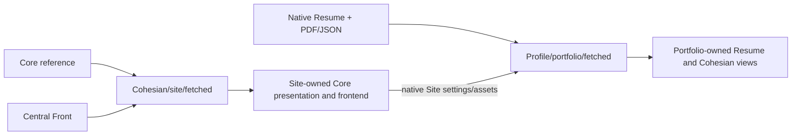

# Workspace Architecture

Workspace is an index of independent repositories, with three local families:
Cohesian, Profile and Projects. Its own Git history owns this documentation,
repositories.json and bootstrap scripts. It ignores all nested project trees;
there are no Git submodules and no shared application build.

## Routing

repositories.json is the source of truth for exact local-path/GitHub mappings.
Registered checkouts may be absent: bootstrap clones missing repos, preserves
existing directories and never resets or pulls. Existing source repositories
are retained when their implementations have been reused in a newer tool.

| Local path | GitHub repository |
|---|---|
| `Cohesian/core` | `cohesian/core` |
| `Cohesian/site` | `cohesian/site` |
| `Cohesian/essays/bookly-up` | `cohesian-essays/bookly-up` |
| `Cohesian/essays/composition-in-go` | `cohesian-essays/composition-in-go` |
| `Cohesian/essays/intro-to-golang` | `cohesian-essays/intro-to-golang` |
| `Cohesian/essays/research` | `cohesian/research` |
| `Cohesian/tools/devky` | `cohesian-tools/devky` |
| `Cohesian/tools/josly` | `cohesian-tools/josly` |
| `Cohesian/tools/k-graph` | `cohesian-tools/k-graph` |
| `Cohesian/tools/loci` | `cohesian-tools/loci` |
| `Cohesian/tools/optional` | `cohesian-tools/optional` |
| `Cohesian/tools/resumy` | `cohesian-tools/resumy` |
| `Cohesian/tools/tether` | `cohesian-tools/tether` |
| `Profile/leetcode` | `lucas-masiero/leetcode` |
| `Profile/pj-homesolution` | `lucas-masiero/pj-homesolution` |
| `Profile/portfolio` | `lucas-masiero/portfolio` |
| `Profile/resume` | `lucas-masiero/resume` |
| `Projects/bookly-up/auth` | `bookly-up/auth` |
| `Projects/bookly-up/booking` | `bookly-up/booking` |
| `Projects/bookly-up/payment` | `bookly-up/payment` |
| `Cohesian/tools/typy` | `cohesian-tools/typy` |
| `Cohesian/arch` | `cohesian/arch` |
| `Cohesian/front` | `cohesian/front` |

## Consumer-owned presentation

Cohesian/arch owns the detailed architecture; see its README.md. Central
Cohesian/front owns the shared tool/essay catalog. Individual tools and essays
remain agnostic and contain no catalog front folders or schema copies.
Core is a currently immutable reference; its existing principles.json stays.

Both consumer repos use `npm run fetch` followed by `npm run build`.
`--local` reads unpublished sibling inputs; default fetch reads published refs.
Build uses only versioned fetched/ data and consumer-owned presentation code.
A source has no responsibility for how a downstream frontend displays it.

Site's native settings live in site.json, Core's adaptation in
presentation/core.json and src/. Portfolio's field selection and Cohesian
cover/card assets/styles live in its own presentation/. Resume owns only its
native CV sources, PDF/JSON pair and generator configuration. Site and Resume
do not expose self-presentation packages.

## Routing and operation

repositories.json remains the exact path/GitHub routing source. No repositories
were relocated by this ownership change. Existing registered checkouts may be
absent; bootstrap fills missing clones without pulling/resetting existing work.
Projects stays independent. K-graph's runtime `dist front` format and Resumy's
native CV schema are implementation features, not catalog front exports.

Use Git independently in each repo. The root history versions only routing,
documentation and bootstrap scripts. A future functions.json can define
add-tool/add-essay workflows; it is still a planned interface.
