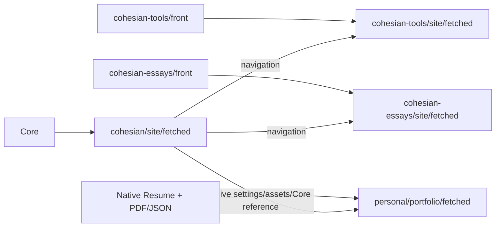

# Workspace Architecture

Workspace is an index of independent repositories, with three local families:
organization, personal and projects. Its own Git history owns this documentation,
repositories.json, setup scripts and the Python Workspace CLI. It ignores all nested project trees;
there are no Git submodules and no shared application build.

## Routing

repositories.json is the source of truth for exact local-path/GitHub mappings.
Registered checkouts may be absent: bootstrap clones missing repos, preserves
existing directories and never resets or pulls. Existing source repositories
are retained when their implementations have been reused in a newer tool.

<!-- workspace-repositories:start -->
| Local path | GitHub repository |
|---|---|
| `organization/cohesian-essays/essays/bookly-up` | `cohesian-essays/bookly-up` |
| `organization/cohesian-essays/essays/composition-in-go` | `cohesian-essays/composition-in-go` |
| `organization/cohesian-essays/essays/dimensional-invariance` | `cohesian-essays/dimensional-invariance` |
| `organization/cohesian-essays/essays/intro-to-golang` | `cohesian-essays/intro-to-golang` |
| `organization/cohesian-essays/essays/research` | `cohesian/research` |
| `organization/cohesian-essays/front` | `cohesian-essays/front` |
| `organization/cohesian-essays/site` | `cohesian-essays/site` |
| `organization/cohesian-tools/front` | `cohesian-tools/front` |
| `organization/cohesian-tools/site` | `cohesian-tools/site` |
| `organization/cohesian-tools/tools/devky` | `cohesian-tools/devky` |
| `organization/cohesian-tools/tools/josly` | `cohesian-tools/josly` |
| `organization/cohesian-tools/tools/k-graph` | `cohesian-tools/k-graph` |
| `organization/cohesian-tools/tools/loci` | `cohesian-tools/loci` |
| `organization/cohesian-tools/tools/optional` | `cohesian-tools/optional` |
| `organization/cohesian-tools/tools/resumy` | `cohesian-tools/resumy` |
| `organization/cohesian-tools/tools/tether` | `cohesian-tools/tether` |
| `organization/cohesian-tools/tools/typy` | `cohesian-tools/typy` |
| `organization/cohesian/arch` | `cohesian/arch` |
| `organization/cohesian/core` | `cohesian/core` |
| `organization/cohesian/site` | `cohesian/site` |
| `personal/portfolio` | `lucas-masiero/portfolio` |
| `personal/repositories/leetcode` | `lucas-masiero/leetcode` |
| `personal/repositories/pj-homesolution` | `lucas-masiero/pj-homesolution` |
| `personal/resume` | `lucas-masiero/resume` |
| `projects/bookly-up/auth` | `bookly-up/auth` |
| `projects/bookly-up/booking` | `bookly-up/booking` |
| `projects/bookly-up/payment` | `bookly-up/payment` |
<!-- workspace-repositories:end -->

## Local namespace layout

```text
organization/
  cohesian/{arch,core,site}
  cohesian-tools/{front,site,tools/<repository>}
  cohesian-essays/{front,site,essays/<repository>}
personal/
  resume
  portfolio
  repositories/{leetcode,pj-homesolution}
projects/
  bookly-up/{auth,booking,payment}
```

Folders are organizational containers; only the indexed leaves are Git repos.
A local namespace does not change GitHub ownership: research, for example,
still belongs to cohesian/research. The old combined cohesian/front is no longer
an active checkout/index entry; its remote history remains intact.

## Consumer-owned presentation

organization/cohesian/arch owns the detailed architecture. The gateway consumes
only immutable Core reference data. Each domain Front owns its presentation
catalog, schemas and assets; each domain Site consumes only that Front.
Individual tools and essays remain agnostic, without front exports.



Sites and Portfolio use `npm run fetch` followed by `npm run build`.
`--local` reads configured sibling inputs; default fetch reads published refs.
Build uses only versioned fetched/ data and consumer-owned presentation code.
A source has no responsibility for downstream rendering.

Site owns site.json and presentation/core.json. Portfolio owns field selection
and Cohesian card assets/styles under presentation/. Resume owns native CV
sources, PDF/JSON output and Resumy configuration. Neither exposes its own front
package. K-graph's runtime formats and Resumy's native CV schema are implementation
features, not catalog exports.

Use Git independently in each repo. The root history owns routing, documentation,
the CLI and setup/bootstrap scripts. A future functions.json can define
add-tool/add-essay workflows; it remains a planned interface.

## Workspace CLI and device seeds

cli/ is an installable Python package (pyproject.toml, src/workspace_cli and
tests). It belongs to this index repository and reads repositories.json;
there is no second inventory. repo list/status/fetch
accept all (default), a GitHub owner, or owner/name and render the local tree.
-l limits display depth with descendant summaries; the query controls operation
scope. Status compares local main with cached origin/main, alongside working
tree edits. Fetch updates origin references without touching working files or
switching branches. repo login delegates device authentication to gh and SSH.

repo check compares registered routes with local origins and discovers new
independent Git roots within the three project families, stopping at each
repository boundary. It is read-only. workspace sync operates on a named side:
index --add/--remove updates the manifest and the marked routing table above;
workdir --clone/--purge fills missing indexed checkouts or moves unregistered
ones into .trash/<unique-batch>/<original-path>. No mode means no changes.
There is no combined all mode. -p aliases --purge; queries/depth work as above.
trash init creates managed .trash idempotently (purge also does this).
trash empty permanently clears its saved contents. The CLI never commits or
pushes index changes. Sync/trash mutations share a workspace-local lock.

scripts/termux/setup.sh uses pkg. scripts/macos/setup.sh uses Homebrew. Both
install development tooling and invoke scripts/install-cli.sh, then login.
The CLI lives in a local, ignored .venv-cli and is linked into ~/.local/bin.
The independent bootstrap remains responsible only for cloning absent leaves.
No project-repository data flow or publishing responsibility changes.
