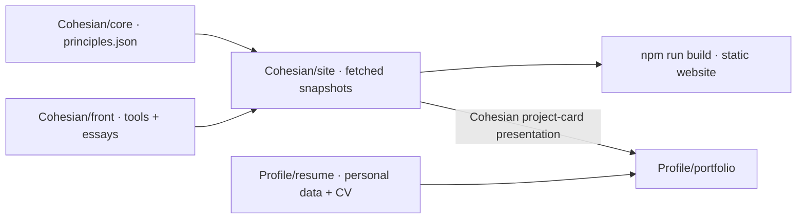

# Workspace Architecture

Workspace is an index of independent repositories, with three local families:
Cohesian, Profile and Projects. Its own Git history owns this documentation,
repositories.json and bootstrap scripts. It ignores all nested project trees;
there are no Git submodules and no shared application build.

## Routing

repositories.json is the source of truth for exact local-path/GitHub mappings.
Registered checkouts may be absent: bootstrap clones missing repos, preserves
existing directories and never resets or pulls. Existing source repositories
are retained when their implementations have been reused in a newer tool.

| Local path | GitHub repository |
|---|---|
| `Cohesian/core` | `cohesian/core` |
| `Cohesian/site` | `cohesian/site` |
| `Cohesian/essays/bookly-up` | `cohesian-essays/bookly-up` |
| `Cohesian/essays/composition-in-go` | `cohesian-essays/composition-in-go` |
| `Cohesian/essays/intro-to-golang` | `cohesian-essays/intro-to-golang` |
| `Cohesian/essays/research` | `cohesian/research` |
| `Cohesian/tools/devky` | `cohesian-tools/devky` |
| `Cohesian/tools/josly` | `cohesian-tools/josly` |
| `Cohesian/tools/k-graph` | `cohesian-tools/k-graph` |
| `Cohesian/tools/loci` | `cohesian-tools/loci` |
| `Cohesian/tools/optional` | `cohesian-tools/optional` |
| `Cohesian/tools/resumy` | `cohesian-tools/resumy` |
| `Cohesian/tools/tether` | `cohesian-tools/tether` |
| `Profile/leetcode` | `lucas-masiero/leetcode` |
| `Profile/pj-homesolution` | `lucas-masiero/pj-homesolution` |
| `Profile/portfolio` | `lucas-masiero/portfolio` |
| `Profile/resume` | `lucas-masiero/resume` |
| `Projects/bookly-up/auth` | `bookly-up/auth` |
| `Projects/bookly-up/booking` | `bookly-up/booking` |
| `Projects/bookly-up/payment` | `bookly-up/payment` |
| `Cohesian/tools/typy` | `cohesian-tools/typy` |
| `Cohesian/arch` | `cohesian/arch` |
| `Cohesian/front` | `cohesian/front` |

## Cohesian

The organization's repositories are **arch**, **core**, **front** and **site**.
`Cohesian/tools/` and `Cohesian/essays/` are local namespace containers for
independent repos; their GitHub namespaces are cohesian-tools and
cohesian-essays. Research retains its existing cohesian/research mapping.

- **arch** owns the full organization architecture and operating workflows.
- **core** owns accepted principles/identity and its versioned JSON export.
- **front** owns one central catalog: tools/schema.json with tools/<slug>/
  instance.json and assets/, and essays/schema.json with essays/<slug>/
  instance.json and assets/. Essays declare book or paper.
- **site** consumes Core and Front; it owns components, routes and deployment.



Front replaces the former per-project front-import arrangement for Site's
catalog. Individual implementations/works remain the factual references;
public metadata is deliberately authored once in Front. The existing Site
project-card export remains separate for Resume and Portfolio.

See [Cohesian Arch](Cohesian/arch/README.md) for complete contracts, boundaries,
source acquisition, validation and publication workflows. This index does not
redefine those application contracts.

## Daily catalog update

Add a tool or essay instance and its assets in Cohesian/front, run its checks,
review and push. Then, from Cohesian/site:

```sh
npm run fetch
npm run build
```

For unpublished sibling content use `npm run fetch -- --local`. Fetch reads
only the central Front and Core repos. Build/dev use committed snapshots and
need no source repo credentials. New folders are discovered automatically;
new unplaced essays get a default shelf. Review/test and commit/push Site to
publish through its existing deployment.

## Profile and Projects

Resume owns personal/career data; Resumy generates its PDF and matching JSON
snapshot. Portfolio consumes Resume and Site's Cohesian presentation. Typy
remains the Go toolbox for ptr, errlay, opt and opt/nullable; the original
Optional repository is independently registered and is not implicitly retired.
Projects remains an independent family for Bookly auth/booking/payment modules.

## Index operations

Read README.md and AGENTS.md before routing work. `scripts/setup-termux.sh`
configures the environment; `scripts/bootstrap.sh` materializes registered
repositories. Bootstrap supports Cohesian, Profile and Projects and leaves
existing work alone. Git actions are per-repository; pushing this root does
not push nested projects.

A future functions.json could define add-tool and add-essay operations with
namespace checks, central Front authoring, Site refresh and index updates.
Those functions are a planned interface, not implemented commands today.
